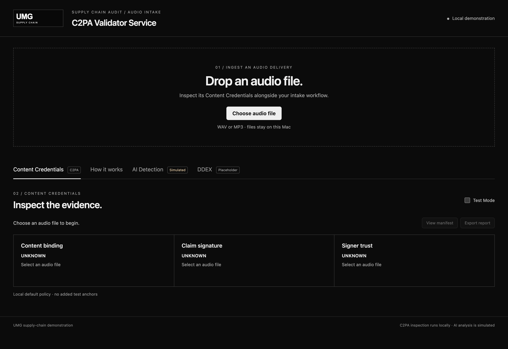
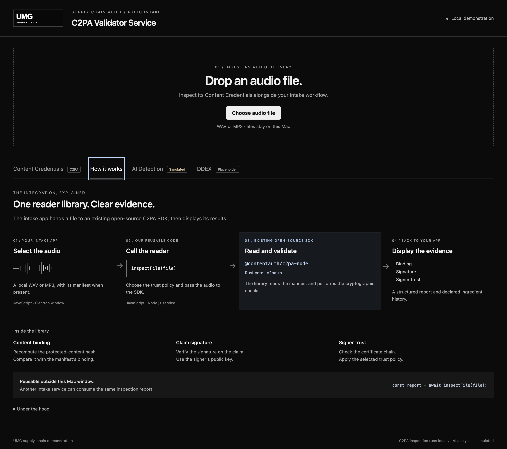

# UMG C2PA Validator Service

A local Mac demonstration of Content Credentials inspection as one module in a music-delivery intake workflow.

**Status:** first working implementation; human review and audible playback acceptance pending.

[Quick start](#quick-start) · [Architecture](docs/architecture.md) · [Test / record a demo](docs/testing.md) · [Integration example](examples/inspect.mjs)


Drop WAV/MP3 audio, see its real Content Credentials and ingredient tree, and open the adjacent intake modules. **AI Detection is simulated; DDEX is an illustrative placeholder.** Audio stays local and the app runs without a web server.



The **How it works** tab, between Content Credentials and AI Detection, explains the actual integration: JavaScript/Node.js → `@contentauth/c2pa-node` → its Rust `c2pa-rs` core → a structured report. A short visual flow separates our reusable service from the SDK and explains binding, signature and trust; implementation details remain collapsed.



## Quick start

Requires macOS and Node.js 22.12+ (Node 24 used for verification).

```sh
npm ci
npm run setup
npm start
```

To build and open a Mac app with its own bundled runtime (requires Xcode Command Line Tools):

```sh
npm run build:mac
npm run open:mac
```

The app is built for the current Mac architecture. Local bundles are ad-hoc signed, not Developer ID notarized distribution releases. New builds preserve previous bundles; `open:mac` opens the latest output.

## Use the reader without the desktop app

```sh
npm run inspect -- "/path/to/audio.wav" --test-mode
```

```js
import { inspectFile } from './src/validator/service.mjs';
const report = await inspectFile('/path/to/audio.wav', { testMode: true });
console.log(report.checks, report.history);
```

`inspectFile` has no Electron dependency. The UI consumes this same versioned report; an intake service could consume it without adopting the desktop window. See [the integration contract](docs/architecture.md).

## Scope

- macOS desktop application, minimalist black interface and text wordmark.
- Real C2PA SDK reading/validation, an explicit session-only Test Mode and ingredient exploration.
- Reusable reader service with no dependency on the desktop UI.
- Local audio preview; no audio upload, signing service, or AI detector API.

This is a demonstration project maintained in a personal repository, not a production UMG supply-chain system or a claim of C2PA product conformance. The UMG name is used for the requested demonstration context; trademark rights are retained by their owners.

## Verification and trust

```sh
npm run check
npm test
npm run test:app
```

`test:app` requires a preceding Mac build. [Signed-file regression and manual checks](docs/testing.md) accept an optional local fixture, which is never committed. Default inspection is offline with no added test anchors; it does not claim an official trust-list implementation. Explicit **Test Mode** trusts only the [pinned public conformance test root](resources/test-trust/NOTICE.md), labels its success and retains signature/binding failures. OCSP and remote manifests are not fetched.

[Local verification evidence and remaining limits](docs/verification.md) records the supplied-file and packaged-window checks.

Source-type labels summarize manifest declarations. Ingredient history does not independently establish the integrity of unavailable source audio. No credentials is not an AI verdict; a successful three-check result is not a C2PA conformance certification.

## Repository

[Contributing](CONTRIBUTING.md) · [Security](SECURITY.md) · [Agent contract](AGENTS.md) · [Claim audit](docs/claim-audit.md) · [Implementation brief](docs/implementation-brief.md)

Do not add private keys, supplied audio, company documents or local validation reports to this public repository. Post-bootstrap changes use a branch/PR; the owner reviews and merges.

## License

Original project code and documentation: [MIT](LICENSE). Third-party components retain their own licenses; the project license does not grant rights to UMG marks or supplied audio.
