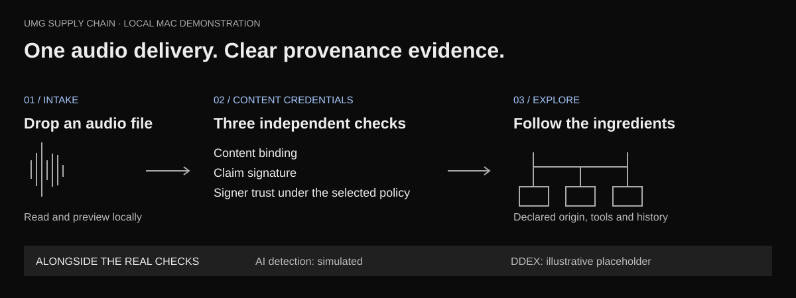

# UMG C2PA Validator Service

A local Mac demonstration of Content Credentials inspection as one module in a music-delivery intake workflow.

**Status:** repository foundation; the desktop application is developed in the first implementation PR.

[Architecture](docs/architecture.md) · [Contributing](CONTRIBUTING.md) · [Security](SECURITY.md)

The demonstration will read an audio file locally, show separate binding/signature/trust results, and display its declared provenance tree. AI detection will be explicitly simulated; DDEX will be an illustrative placeholder.

## Scope

- macOS desktop application, minimalist black interface and text wordmark.
- Real C2PA SDK reading/validation, an explicit session-only Test Mode and ingredient exploration.
- Reusable reader service with no dependency on the desktop UI.
- Local audio preview; no audio upload, signing service, or AI detector API.

This is a demonstration project maintained in a personal repository, not a production UMG supply-chain system or a claim of C2PA product conformance. The UMG name is used for the requested demonstration context; trademark rights are retained by their owners.

## Development

Application setup and test commands will accompany the implementation PR. Do not add private keys, supplied audio, company documents, or local validation reports to this public repository.

## License

Original project code and documentation: [MIT](LICENSE). Third-party components retain their own licenses; the project license does not grant rights to UMG marks or supplied audio.
