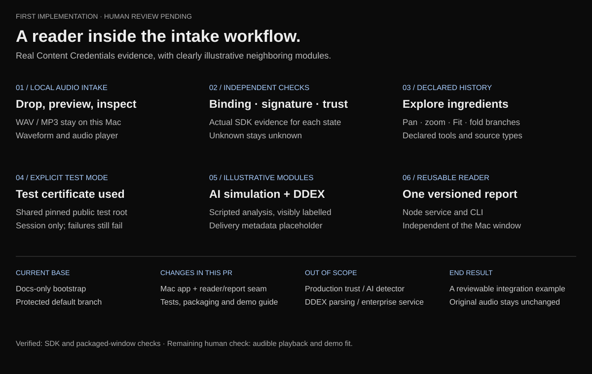

# First implementation PR — local Mac intake and reusable C2PA reader

## Goal

Demonstrate a real Content Credentials reader as one inspection module in a familiar music-delivery intake screen. Audience: music supply-chain operators and engineers assessing an integration seam. The demo proves file-to-report-to-UI behavior; it does not measure production integration cost.

## Transparency / change ledger

| Layer | Change and boundary |
| --- | --- |
| Starting point | New public repository; bootstrap contains documentation/governance only. |
| User-visible behavior | Local audio intake/preview, three real validation checks, manifest display, navigable history, explicit Test Mode and a visual How it works explanation. |
| Code | Framework-independent Node reader/report mapper; Electron broker/worker; static local renderer under `frontend/`. |
| Illustrative modules | AI results are scripted and visibly simulated; DDEX is an empty placeholder. |
| Data / persistence | Selected media and test policy remain session-local; explicit report export only. Supplied media stays outside Git. |
| Audio | Read-only local preview; no source mutation, transcoding, recording, signing or watermark recovery. |
| C2PA | Official pinned SDK; no trust bypass, no automatic promotion of asset certificates, separate root-asset outcomes and ingredient history. |
| Verification | Pure mapping tests, real SDK unsigned/malformed and context tests, optional supplied signed fixture with PCM tamper, packaged-window interaction tests. |
| Human acceptance | Audible playback, appearance on the user's display, representative external assets and demonstration pacing. |

## Implementation scope

1. Import a local WAV/MP3 through file dialog or drag/drop; show filename, size, real waveform and player.
2. Call `inspectFile` in an independent worker and display binding, signature and signer trust separately.
3. Enable the pinned public C2PA Conformance Test Root only through explicit session-local Test Mode; label its successful result and preserve failures.
4. Show a connected ingredient tree with pan/zoom/fit/branch expansion and full declared actions/tools in details; preserve raw SDK JSON.
5. Supply an AI-detection simulation that does not read its result from C2PA or claim actual detection; leave DDEX illustrative.
6. Package a Mac app with its own runtime so opening it does not require launching a web server.
7. Explain our reusable Node service versus the existing Rust-backed C2PA SDK in a minimal **How it works** tab between Content Credentials and AI Detection, with optional implementation detail.

## Acceptance

- Default context: valid signature may coexist with untrusted signer.
- Test Mode: a correct chain to the pinned test root can become trusted; altered PCM still fails binding.
- Unsigned audio: No embedded Content Credentials and N/A checks, with no AI-origin conclusion.
- Malformed input: inspection error, never an unsigned-file success.
- Embedded ingredient history is navigable without claiming original ingredient audio was independently supplied or checked.
- No renderer Node integration, arbitrary shell/file bridge, remote code, detector API or audio upload.
- Public commits contain no provided WAV/DOCX, private keys, machine paths, raw private reports or private screenshots.

## Non-goals and stop conditions

No production supply-chain integration, official trust-list lifecycle, C2PA product certification, DDEX parsing, AI detector integration, rights clearance or deployment service. Additions require a separate agreed scope. Never weaken evidence/verification to obtain a green result. Do not merge; the owner reviews the implementation PR.
